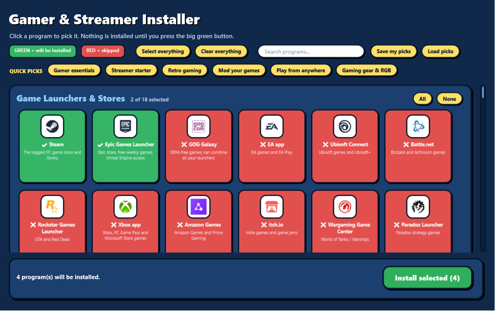

# Gamer & Streamer Installer

A friendly installer window for gamers and streamers. Click the programs you want, press one button, and they download and install quietly through Windows' built-in package manager (winget).

**99 programs in 9 categories:** Game stores and launchers, mod tools, streaming and recording, capture and audio, remote play, hardware tools, gaming gear software and emulators.



## Download

Get the latest version from the **[Releases page](../../releases/latest)**:

- **`Gamer-Installer.exe`**: double-click and the window opens.
- Or **`Gamer-Installer.zip`**, which contains the same thing as plain files. It also has an "(Admin)" launcher that asks for administrator permission once instead of for every program.
- `SHA256SUMS.txt` lets you check your download.

> **Windows may warn you** ("Windows protected your PC"). The `.exe` is not digitally signed, because code-signing certificates cost money. Click **More info → Run anyway**, or read the source in this repo and build the file yourself (see below).

## How to use

1. Open the installer.
2. **Click programs to pick them.** Green = will be installed. Red = skipped.
3. Use the **Quick picks** buttons to add a ready-made group of programs. They only *add* programs; *Clear everything* starts over.
4. Use the **search box** to find a program by name or by what it does.
5. Programs you already have are marked **Installed on this PC**, and ones with a newer version say **Update available**.
6. Press the big green **Install selected** button and confirm. Programs install one after another, with a progress bar and a log. **Stop after this program** is available while it runs.

Nothing is installed until you press the green button and confirm. Some programs may show a Windows permission (UAC) prompt, which is normal.

Requirements: Windows 10 (1809 or newer) or Windows 11 with winget ("App Installer", already on most PCs), and an internet connection.

## Features

- **Quick picks**: one click adds a ready-made group of programs.
- **Search** by name or by what a program does.
- **Installed on this PC** and **Update available** markers, and an **Update installed programs** button.
- **Save my picks / Load picks**: keep your selection in a file and use it on another PC.
- **Clear failure reasons** and a **Retry failed** button, with a log of every run saved to `%LOCALAPPDATA%\PCInstallers\logs`.
- **Sensible install order** and a **restart notice** when programs need one.
- If **winget is missing**, the window says so and offers a button to get it from the Microsoft Store.

## What the .exe does

The `.exe` is a tiny launcher. It unpacks the installer files into `%LOCALAPPDATA%\PCInstallers\Gamer\` and opens the installer window with PowerShell. Everything else is plain, readable PowerShell in [`src/`](src/). Programs are installed only through `winget install`.

## The program list

See [docs/GAMER-LIST.md](docs/GAMER-LIST.md). Every winget package ID was checked to exist when the list was made.

## Build it yourself

You need nothing but Windows:

```powershell
powershell -ExecutionPolicy Bypass -File build\Build.ps1
```

This creates the `.zip` and `.exe` in `dist\`, using only Windows' own zip support and the C# compiler that ships with .NET Framework 4.

## Add or remove programs

Edit `src/gamer-catalog.json`. Each entry has `category`, `name`, `id` (the winget ID), `source` (`winget` or `msstore`) and `description`. Find an ID with `winget search <name>`. Quick picks live in `src/gamer-presets.json`, and the programs that start ticked are the `starter` list in `src/gamer.config.json`. Logos go in `src/icons/` and are linked from `src/gamer-icons.json`; programs without a logo show a colored letter badge.

## Notes

- Emulators do not include games or console BIOS files. You need your own legally obtained copies.
- A few programs are not on winget and have to be downloaded by hand; they are listed at the bottom of the program list.
- See [NOTICE.md](NOTICE.md) for logo and trademark information.

## License

MIT, see [LICENSE](LICENSE). Program names, logos and trademarks belong to their owners.